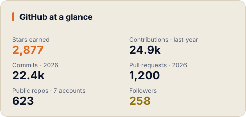
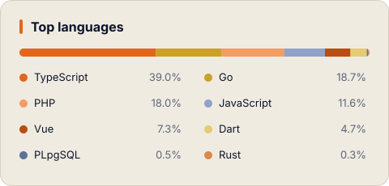
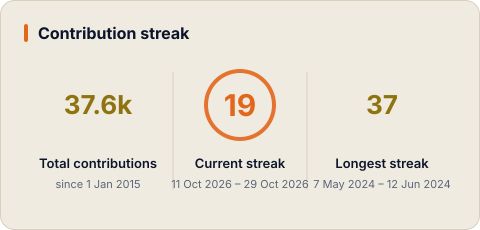
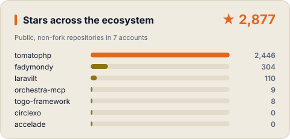

<picture>
  <source media="(prefers-color-scheme: dark)" srcset="assets/brand/mark-dark.svg" />
  
</picture>

# Fady Mondy

**Applied AI & full-stack engineer · creator of [ToGO](https://to-go.dev)**

I build open-source, agent-ready products (memory, CRM, project management, hosting) on one Go framework, and ship them in English and Arabic.

بابني منتجات مفتوحة المصدر جاهزة للـ AI agents، كلها مبنية على ToGO، وبالعربي والإنجليزي.

---

## 🐹 ToGO, the foundation

**[ToGO](https://to-go.dev)** is an open-source, API-first full-stack framework: Go + sqlc + Atlas + React, with a Laravel-artisan-grade CLI, a plugin marketplace and an MCP server so AI agents can generate code with it. Every product below runs on it.

[to-go.dev](https://to-go.dev) · [GitHub](https://github.com/togo-framework/togo) · [Discord](https://discord.gg/6ejdqCUMdH) · [Product Hunt](https://www.producthunt.com/products/togo-2) · `npm i -g @togo-framework/cli`

### Built with ToGO

| Product | What it does | Links | |
|---|---|---|---|
| 🧠 **Zekra** | Long-term memory for AI agents over MCP: hybrid recall, knowledge graph and chat with citations. Works with Claude Code, Cursor and Codex. Desktop for Mac, Windows and Linux; iOS and Android in beta. **Launched on Product Hunt, 14 Oct 2026.** | [zekra.dev](https://zekra.dev) · [GitHub](https://github.com/fadymondy/zekra) · [Discord](https://discord.gg/99JBJd6FsR) · [Product Hunt](https://www.producthunt.com/posts/zekra) |    |
| ✅ **Mahaam** | Project management for agencies: projects, issues, time tracking, invoices, a customer portal and AI agents over MCP. | [mahaam.app](https://mahaam.app) · [GitHub](https://github.com/fadymondy/mahaam) · [Discord](https://discord.gg/a59RzxnB2H) |   |
| 💬 **Moharrik** | An AI engine for a business: CRM plus a shared WhatsApp and email inbox, leads, email marketing and automation. Every capability is an MCP tool. | [moharrik.com](https://moharrik.com) · [GitHub](https://github.com/fadymondy/moharrik) · [Discord](https://discord.gg/BMERkavdVq) |   |
| 🖥️ **Hosbah** | Server management and app hosting on your own servers or Proxmox: zero-downtime deploys, databases, backups and tunnels, with an MCP server. | [hosbah.com](https://hosbah.com) · [GitHub](https://github.com/fadymondy/hosbah) |   |
| 🛠️ **ToGO Builder** | An agent fleet that turns reported issues into shipped fixes, with a second agent and a human between every change and production. | [GitHub](https://github.com/togo-framework/builder) |   |

---

## 🧩 More open source

| Project | What it does | Links | |
|---|---|---|---|
| 🎨 **Nasaq** | A design system with 392 components for React, Vue, Laravel Blade and HTML. Arabic and RTL built in, plus a shadcn registry and an MCP server. | [nasaqui.com](https://nasaqui.com) · [GitHub](https://github.com/fadymondy/nasaq) |    |
| ⭕ **CircleXO** | One account and one bill for a family of business apps: Matjar, Makhzan, Mawared and Qaima (open-sourcing in progress). Go SDK for sign-in, entitlements, usage billing and MCP auth. | [circlexo.com](https://circlexo.com) · [Docs](https://github.com/circlexo/docs) · [Go SDK](https://github.com/circlexo/circlexo-go) |   |
| 🎛️ **Laravilt** | A modern admin panel framework for Laravel 13, rendered with Inertia on Vue 3 or React 19, with built-in AI. | [laravilt.com](https://laravilt.com) · [GitHub](https://github.com/laravilt/laravilt) · [Discord](https://discord.gg/as2j7BW7Yc) · [Product Hunt](https://www.producthunt.com/products/laravilt) |    |
| 🍅 **TomatoPHP** | 180 open-source Laravel and FilamentPHP packages: CMS, e-commerce, invoices, POS, tenancy, media and more. | [tomatophp.com](https://tomatophp.com) · [GitHub](https://github.com/tomatophp) · [Discord](https://discord.gg/ggSfrWSA87) · [Product Hunt](https://www.producthunt.com/products/tomato-php) |    |
| 🤖 **Orchestra MCP** | An AI-agentic IDE framework on a plugin host: storage, tools, transport and AI are all plugins talking over QUIC with mTLS. | [orchestra-mcp.dev](https://orchestra-mcp.dev) · [GitHub](https://github.com/orchestra-mcp/framework) |    |

### Claude Code toolkit

| Plugin | What it does | |
|---|---|---|
| 👥 **[Claude Agents Team](https://github.com/fadymondy/agents-team)** | Generates a full agent team (orchestrator, specialists, `/meet` sessions) and lints agent quality. |   |
| 📋 **[Claude GitHub PMS](https://github.com/fadymondy/gh-pms)** | GitHub Issues as a project-management system: plans, evidence-gated lifecycle, PR-driven review. |   |
| 🔔 **[Claude Notifications](https://github.com/fadymondy/claude-notifications)** | Alerts when Claude finishes or needs you: Slack, Discord, email, WhatsApp, desktop voice, web push. |   |
| 📸 **[Claude Cap](https://github.com/fadymondy/claude-cap)** | Captures a Chrome tab with its URL, network and console and hands the bundle to Claude over MCP. |  |

---

## 📊 Stats

  <picture>
    <source media="(prefers-color-scheme: dark)" srcset="assets/generated/stats-dark.svg" />
    
  </picture>
  <picture>
    <source media="(prefers-color-scheme: dark)" srcset="assets/generated/languages-dark.svg" />
    
  </picture>

  <picture>
    <source media="(prefers-color-scheme: dark)" srcset="assets/generated/streak-dark.svg" />
    
  </picture>
  <picture>
    <source media="(prefers-color-scheme: dark)" srcset="assets/generated/stars-dark.svg" />
    
  </picture>

<table>
<tr>
<td valign="top" width="50%">

### 🚀 Recent releases

<!-- RELEASES:START -->
- [**nasaq** v1.4.0](https://github.com/fadymondy/nasaq/releases/tag/%40fadymondy/nasaq%401.4.0) · fadymondy · 14 Oct 2026
- [**nasaq-theme-sdk** v0.2.0](https://github.com/fadymondy/nasaq-theme-sdk/releases/tag/v0.2.0) · fadymondy · 13 Oct 2026
- [**togo** v0.21.1](https://github.com/togo-framework/togo/releases/tag/v0.21.1) · togo-framework · 13 Oct 2026
- [**cli** v0.2.36](https://github.com/togo-framework/cli/releases/tag/v0.2.36) · togo-framework · 13 Oct 2026
- [**filament-media-manager** v5.0.2](https://github.com/tomatophp/filament-media-manager/releases/tag/v5.0.2) · tomatophp · 13 Oct 2026
- [**filament-saas-panel** v5.0.2](https://github.com/tomatophp/filament-saas-panel/releases/tag/v5.0.2) · tomatophp · 13 Oct 2026
<!-- RELEASES:END -->

</td>
<td valign="top" width="50%">

### ✍️ Latest from the blog

<!-- BLOG:START -->
- [Full-Time CTO vs Fractional CTO vs Technical Consultant: Which Does Your Company Need?](https://fadymondy.com/en/blog/full-time-cto-vs-fractional-cto-vs-technical-consultant) · 14 Oct 2026
- [From Separate Projects to One Ecosystem: What I Learned Building Developer Tools](https://fadymondy.com/en/blog/from-projects-to-an-ecosystem) · 12 Oct 2026
- [Laravel AI Integration: Is There a LangChain for PHP, and What Should You Use?](https://fadymondy.com/en/blog/laravel-ai-integration-langchain-php) · 12 Oct 2026
- [Who Is Fady Mondy? Applied AI Engineer, Fractional CTO and Founder of TomatoPHP](https://fadymondy.com/en/blog/who-is-fady-mondy) · 12 Oct 2026
- [How to Ship an Official MCP Server for Your SaaS in 2 Weeks](https://fadymondy.com/en/blog/ship-official-mcp-server-for-saas-in-2-weeks) · 11 Oct 2026
<!-- BLOG:END -->

[More on fadymondy.com →](https://fadymondy.com/en/blog)

</td>
</tr>
</table>

---

### ❤️ Support the work

Everything above is built and maintained in the open. If it saves you time, a star helps, and a sponsorship keeps the releases shipping.

Stats, releases and posts refresh daily with <a href=".github/workflows/profile.yml">a GitHub Action</a>.

